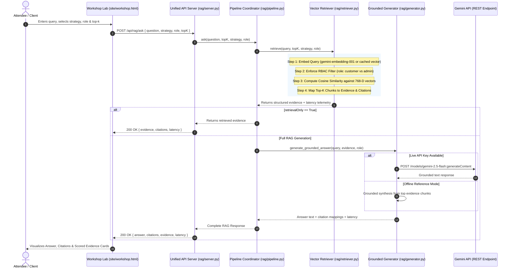

# RAG System Architecture Specification (Gate 2)

## 1. Architectural Overview

The Quirk & Quanta RAG foundation is designed as a modular, local-first retrieval engine built without external database dependencies or third-party package runtimes. It is engineered to educate workshop attendees on the mechanics of dense vector retrieval, chunking variations, citation mapping, and Role-Based Access Control (RBAC).



---

## 2. Core Subsystems

### 2.1 The Document Corpus (`data/corpus/`)
Raw internal records are transformed into structured, self-contained Markdown dossiers:
- **`corpus_public.json`:** 341 documents safe for customer exploration:
  - `DOC-PROD-{sku}-DESC`: Product briefs, themes, tags, and key features.
  - `DOC-PROD-{sku}-SPEC`: Comprehensive technical attributes, pricing, dimensions, and materials.
  - `DOC-PROD-{sku}-POL`: Warranty terms, return conditions, and shipping estimates.
  - `DOC-SUP-{id}`: Supplier manufacturing dossiers, certifications, and lead times.
  - `DOC-COMP-{id}`: Component engineering specifications and alloy compliance.
  - `DOC-REC-{id}`: Quality control recall notices and mandatory remediation steps.
- **`corpus_internal.json`:** 100 confidential procurement dossiers:
  - `DOC-INT-{sku}-PROC`: Wholesale acquisition cost (`costPrice`), gross margin amount (`marginAmount`), profit margin percentage (`marginPercent`), supplier part codes, manufacturing batch IDs, and engineering defect observations. Restricted strictly to `admin` and `procurement` roles.

### 2.2 Chunking Engine (`data/chunks/`)
Supports three distinct chunking algorithms with deterministic IDs:
1. **Fixed-Size Chunking (`CHK-{docId}-FIX-{index}`):**
   - 450-character window with zero overlap.
   - Preserves word boundaries without slicing words mid-token.
   - Result: 1,181 chunks (mean length 373.3 chars).
2. **Sliding-Window Chunking (`CHK-{docId}-SLD-{index}`):**
   - 450-character window with a 150-character rolling overlap.
   - Ensures cross-boundary concepts are captured together.
   - Result: 1,512 chunks (mean length 394.9 chars).
3. **Semantic / Structural Chunking (`CHK-{docId}-SEM-{slug}-{index}`):**
   - Breaks documents along natural Markdown section boundaries (`## Overview`, `## Verified Attributes`, `## Return Protocol`, `## Capabilities`).
   - Prepends top-level contextual breadcrumbs (`[Product Title | Section: Name]`) so each chunk is self-contained.
   - Result: 1,623 chunks (mean length 369.3 chars).

### 2.3 Embedding Engine (`data/embeddings/v1/`)
- **Model:** `gemini-embedding-001`.
- **Dimensions:** 768 dimensions.
- **Normalization:** All vectors are $L_2$-normalized:
  $$\|\mathbf{v}\|_2 = \sqrt{\sum_{i=1}^{768} v_i^2} = 1.0$$
- **Task Types:** `RETRIEVAL_DOCUMENT` for corpus chunks and `RETRIEVAL_QUERY` for user questions.
- **Dual Execution Modes:**
  - **Live Mode:** When `GEMINI_API_KEY` is set, calls `models/gemini-embedding-001:batchEmbedContents`.
  - **Offline Mode:** Generates deterministic normalized feature vectors and loads precomputed query embeddings from `query_embeddings_cache.json`.

### 2.4 Vector Similarity & RBAC Engine (`rag/retriever.py`)
Cosine similarity between normalized query vector $\mathbf{q}$ and chunk vector $\mathbf{d}$ is computed via dot product:
$$\text{sim}(\mathbf{q}, \mathbf{d}) = \sum_{i=1}^{768} q_i d_i$$
- **Role-Based Filtering:**
  - If `role == "customer"`: Chunks with `accessLevel != "public"` are excluded before similarity calculation.
  - If `role in ["admin", "procurement"]`: Confidential chunks are included.

### 2.5 Grounded Answer Generation (`rag/generator.py`)
- **System Guardrails:**
  - Strict grounding: The model answers exclusively using facts from retrieved evidence.
  - Explicit abstention: If facts are missing, returns *"I do not have sufficient peer-reviewed data in the Quirk & Quanta catalog to answer this question."*
  - Security refusal: Rejects requests for confidential pricing from unauthorized roles.
  - Verifiable citation brackets: `[SKU: QQ-XXXX]` or `[Doc: DOC-XXXX]`.

---

## 3. Storage Hierarchy

```text
quirk-and-quanta/
├── data/
│   ├── internal/                       # Canonical Gate 1 ground truth (JSON)
│   ├── corpus/                         # Structured RAG document corpus
│   │   ├── corpus_public.json          # 341 public documents
│   │   ├── corpus_internal.json        # 100 confidential documents
│   │   └── corpus_manifest.json        # Corpus metadata & SHA-256 hashes
│   ├── chunks/                         # Multi-strategy chunked text datasets
│   │   ├── chunks_fixed.json           # 1,181 fixed-size chunks
│   │   ├── chunks_sliding.json         # 1,512 sliding-window chunks
│   │   ├── chunks_semantic.json        # 1,623 semantic chunks
│   │   └── chunks_manifest.json        # Chunk telemetry & length distributions
│   ├── embeddings/
│   │   └── v1/                         # Versioned vector storage
│   │       ├── embeddings_fixed.json   # 1,181 768-D vectors
│   │       ├── embeddings_sliding.json # 1,512 768-D vectors
│   │       ├── embeddings_semantic.json# 1,623 768-D vectors
│   │       ├── query_embeddings_cache.json # 22 cached query vectors
│   │       └── embeddings_manifest.json# Embedding configuration & dimensions
│   └── evaluation/
│       ├── golden_dataset.json         # 22 curated test questions (8 families)
│       └── eval_results.json           # Empirical benchmark measurements
├── rag/                                # Core RAG Python package
│   ├── __init__.py
│   ├── retriever.py                    # Vector similarity & RBAC search
│   ├── generator.py                    # Grounded answer synthesis
│   ├── pipeline.py                     # End-to-end coordinator
│   └── server.py                       # Unified HTTP server (API + site)
└── site/
    └── workshop.html                   # Interactive Workshop Lab UI
```
