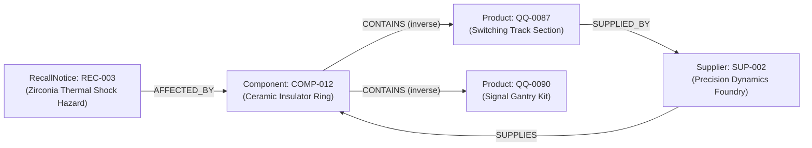

# Knowledge Graph & Data Relationships Specification

This document details the multi-entity relationship architecture defined in `data/internal/graph-relationships.json` for Neo4j AuraDB and GraphRAG demonstrations.

---

## 1. Node Types in Knowledge Graph

The Quirk & Quanta ecosystem consists of 7 primary node labels:

| Node Label | Count | Primary Key | Description |
| :--- | :--- | :--- | :--- |
| **`Product`** | 100 | `sku` (`QQ-0001` - `QQ-0100`) | The core catalog apparatus. |
| **`Category`** | 10 | `id` (`CAT-APPAREL` etc.) | Scientific discipline grouping. |
| **`Collection`** | 8 | `id` (`COL-QUANTUM` etc.) | Curated lifestyle themes. |
| **`Supplier`** | 12 | `id` (`SUP-001` - `SUP-012`) | Fictional component and finished-goods manufacturers. |
| **`Component`** | 24 | `id` (`COMP-001` - `COMP-024`) | Raw materials, alloys, sensors, and electronic sub-assemblies. |
| **`RecallNotice`**| 5 | `id` (`REC-001` - `REC-005`) | Quality control recall records documenting component defects. |
| **`Policy`** | 8 | `id` (`POL-RET-14`, `POL-WAR-12` etc.)| Official return, warranty, and shipping guidelines. |

---

## 2. Relationship Types (Edges)

The graph contains **1,206 total edges** across 10 relationship types:

| Relationship Type | Source | Target | Edge Count | Purpose |
| :--- | :--- | :--- | :--- | :--- |
| **`RELATED_TO`** | Product | Product | 300 | Symmetrical conceptual similarity. |
| **`GOVERNED_BY`** | Product | Policy | 272 | Maps return, warranty, and shipping policies. |
| **`CONTAINS`** | Product | Component | 179 | Bills of materials linking products to parts/alloys. |
| **`BUNDLED_WITH`** | Product | Product | 103 | "Frequently Synergized Together" bundles. |
| **`BELONGS_TO`** | Product | Category | 100 | Canonical category taxonomy. |
| **`SUPPLIED_BY`** | Product | Supplier | 100 | Primary finished-goods assembly vendor. |
| **`PART_OF`** | Product | Collection | 100 | Curated aesthetic collection taxonomy. |
| **`SUPPLIES`** | Supplier | Component | 24 | Vendor sourcing for individual components. |
| **`COMPATIBLE_WITH`**| Product | Product | 23 | Functional or electrical compatibility. |
| **`AFFECTED_BY`** | Component | RecallNotice | 5 | Direct linkage between defective component and recall batch. |

---

## 3. Multi-Hop Graph Traversal Pathways (GraphRAG)

In Gate 4 and Gate 7, workshop attendees will witness where traditional vector search fails and how knowledge graph traversal solves multi-hop reasoning.

### Key Multi-Hop Pathway: The Defective Ceramic Insulator (`REC-003`)
Consider the workshop query:
> *"Which products in our catalog are affected by the recent thermal shock recall on zirconia ceramic insulators, and who is the responsible supplier?"*



**Why Vector RAG Fails:**
- The product descriptions for `QQ-0087` and `QQ-0090` describe model railway track sections and signal gantries; they do not mention `REC-003` or "thermal shock fracture".
- The recall document `REC-003` mentions `COMP-012`, but not individual end-product SKUs.
- Pure vector similarity scores between the query and product documents are near zero.

**How GraphRAG Solves It (Cypher Query):**
```cypher
MATCH (r:RecallNotice {id: 'REC-003'})<-[:AFFECTED_BY]-(c:Component)<-[:CONTAINS]-(p:Product)
MATCH (s:Supplier)-[:SUPPLIES]->(c)
RETURN p.sku, p.name, c.name, s.name, r.defectDescription;
```
This multi-hop traversal immediately surfaces `QQ-0087` and `QQ-0090` with zero hallucinations and full provenance.
